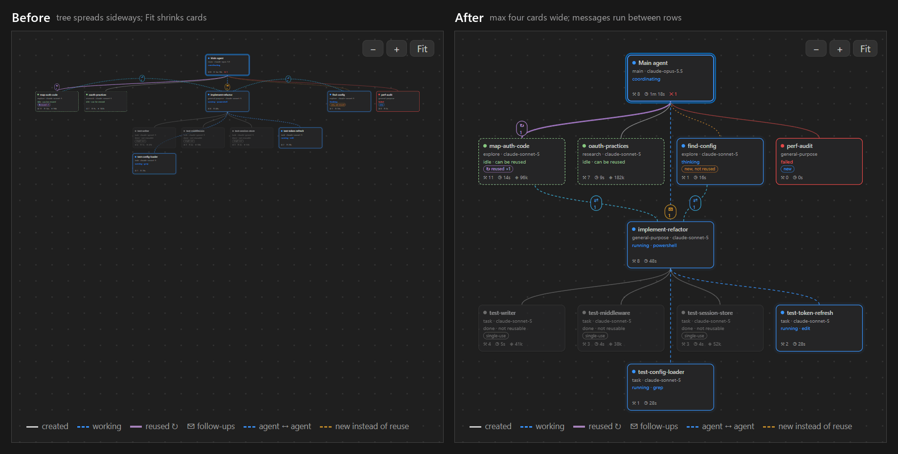

# Changelog

## 0.1.1

- Update notifications: once a day the extension checks this project's GitHub releases and offers to install a newer version (Update, Release Notes, or Skip This Version). It verifies the download against the release checksum. Turn it off with `copilotAgentMonitor.checkForUpdates`, or run **Check for Updates** at any time.
- Graph layout: the graph is never more than four cards wide, so larger sessions grow downward instead of sideways and cards stay readable. A sub-agent with its own sub-agents brings that nested group with it, on a row below its siblings.
- Messages between sub-agents on different rows run through the gap between the rows, so cards no longer hide them.
- The details panel and activity feed move below the graph in windows narrower than 900px (previously 760px), giving the graph the full width.
- Feedback: a **Feedback** section in the README links to new GitHub issue forms for bug reports and feature requests.
- **Open chat**: a toolbar button opens the monitored session's conversation in VS Code chat. It appears only for sessions this window can open (Copilot CLI sessions run by VS Code's agent host, and VS Code Local chats from this window's workspace).

## 0.1.0

- Live graph of the main agent and its sub-agents (nesting, status, model, tools, tokens).
- Classifies every hand-over: new agent, reuse of an idle agent, follow-up to a running agent, sub-agent ↔ sub-agent message, result collection.
- Highlights new agents created while an idle agent of the same type could have been reused.
- Plain-language activity feed, a details panel and status bar counts.
- Sources: Copilot CLI / SDK session logs and VS Code Local-harness transcripts; follows the most recently active session.
- Streams multi-GB logs incrementally.
