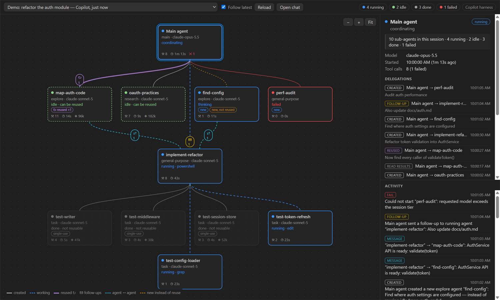
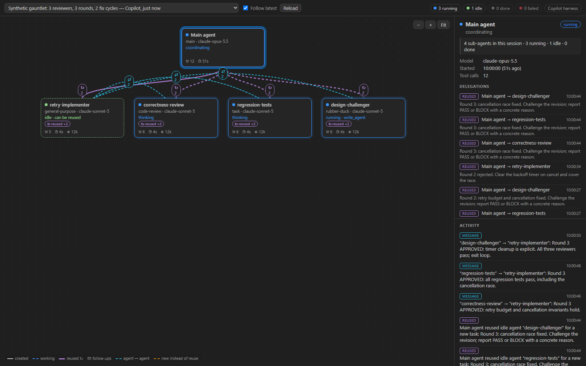

## Copilot Agent Monitor

A live, visual map of what your Copilot agent is doing with its **sub-agents**: when it creates them, what each one is working on, and, when the next task comes along, whether it **reuses** an existing agent or **creates a new one**.

Inspired by the Agent Manager in Google Antigravity.

Trying it out? [Share feedback or report a bug](#feedback). Rough notes and screenshots are welcome.



## What you see

| Visual | Meaning |
| --- | --- |
| Blue pulsing card, animated dashed edge | Agent is working |
| Green dashed card, “idle · can be reused” | Finished but kept alive; it can take another task |
| Grey card, “single-use” | Finished and discarded (sync or VS Code Local sub-agents) |
| Red card | Failed to start or failed while running |
| Thick purple edge, **↻ n** chip, “reused ×n” badge | The agent got *n* new tasks **after** it had finished (reuse) |
| **✉ n** chip | Follow-ups sent while the agent was still running |
| Dashed cyan arc, **⇄ n** | Messages between two sub-agents, in either direction (hover for the count each way) |
| Dashed orange edge, “new, not reused” badge | A **new** agent was created while an idle agent of the same type could have been reused |
| Moving dot along an edge | A task or message is being handed over right now |

The side panel shows the selected agent's details (type, model, reusable or not, tokens, tasks received, recent tools). Below it is an **activity feed** that narrates the orchestration in plain language, for example *“Main agent reused idle agent “map-auth-code” for a new task: …”*. In windows narrower than 900px, the panel and feed move below the graph.

The status bar shows how many sub-agents are running or idle. Click it to open the monitor.

## Feedback-loop example

An agent orchestration can repeat a review-and-fix cycle rather than delegate each task once.
This synthetic, gauntlet-style example keeps one implementer and three reviewers alive across
three rounds. Correctness review, regression tests, and a design challenger report blockers;
the coordinator sends the implementer back for two fix cycles. The loop exits only when all
three reviewers approve the same revision.



Purple **reused ×2** badges show repeat assignments. Cyan message arcs show reviewers sending
feedback to the implementer and the implementer announcing revisions for another review.
Select an agent to inspect the round-by-round messages. These are existing orchestration
visuals, not a separate loop detector or an implementation of a specific Gauntlet framework.

## Install and update

1. Download `copilot-agent-monitor-<version>.vsix` from the [latest release](https://github.com/gemmasuen/copilot-agent-monitor/releases/latest).
2. In VS Code, run **Extensions: Install from VSIX…** and choose the file, or run
   `code --install-extension copilot-agent-monitor-<version>.vsix`.

After that, the extension checks for new releases once a day. When one is available, select
**Update** to download and install it, then **Restart Extensions**. You can also run
**Copilot Agent Monitor: Check for Updates** at any time. To stop the daily check, turn off
`copilotAgentMonitor.checkForUpdates`.

If you installed version 0.1.0, install 0.1.1 or later once by hand; update checks start from that version.

## Usage

- **Copilot Agent Monitor: Open Agent Monitor** opens the graph beside your editor.
- **Follow latest** (on by default) switches to the most recently active session once the current one has been quiet for 20 seconds.
- **Copilot Agent Monitor: Select Session…** pins a specific session (this turns Follow off).
- **Reload** re-reads the session from disk.
- **Open chat** opens the session's conversation in VS Code chat. It only appears for sessions this
  window can open: Copilot CLI sessions run by VS Code's agent host, and VS Code Local chats from the
  workspace that is open in this window. Copilot CLI sessions started from a terminal have no button.
- Graph controls: scroll to zoom, drag to pan, **Fit** to reset the view, and click a card or a feed entry to inspect it.

The graph is never more than four cards wide, so larger sessions grow downward. A sub-agent that
created its own sub-agents brings that nested group with it, below the sub-agents that did not,
and a group that is four cards wide takes a row of its own. Sub-agents that message each other
stay together on one row when they fit. Every row has the same gap, so lines and chips sit between
cards, and lines to later rows run down a gap between the cards above.

## Data sources

The extension only **reads** local log files, and their contents never leave your machine. Its only
network request is the optional daily [update check](#install-and-update), which downloads release
information from GitHub.

| Source | Location | Reuse possible? |
| --- | --- | --- |
| Copilot CLI / Copilot SDK harness | `~/.copilot/session-state/<id>/events.jsonl` | **Yes**: background sub-agents stay alive and can receive follow-ups (`write_agent`). |
| VS Code Local harness | `<VS Code user dir>/workspaceStorage/*/GitHub.copilot-chat/transcripts/*.jsonl` | **No**: every `runSubagent` call is a new, single-use agent. Their inner tool calls are not recorded. |

To find the conversation for **Open chat**, the extension also reads one setting from VS Code's agent
host data (`<VS Code user dir>/agentSessionData/*/session.db`): which Copilot CLI session each agent-host
session belongs to. It needs a VS Code whose built-in Node.js includes `node:sqlite`; without it, the
button stays hidden for Copilot CLI sessions.

The session list uses the titles VS Code shows in its Sessions view. It reads them from VS Code's chat
index (`<VS Code user dir>/workspaceStorage/*/state.vscdb`), falling back to the agent-host
`session.db` title. Until VS Code has named a session, or without `node:sqlite`, the list shows the
session's first prompt instead.

How agents are recognised (Copilot harness):

- `subagent.started` / `subagent.configured` / `subagent.completed` give the agent's identity, model, `multiTurn` flag and totals.
- Tool events carry the `agentId` of the agent that ran them, so nesting and per-agent activity are exact.
- `write_agent` / `read_agent` with an `agent_id` mark reuse, follow-ups and result collection. Sibling broadcasts are resolved from the delivery result.

Both formats are internal and undocumented, so the parser is deliberately tolerant. Logs of several GB are streamed, and irrelevant lines are skipped without being parsed (a 2.1 GB session loads in about 1.5 s).

## Settings

| Setting | Default | |
| --- | --- | --- |
| `copilotAgentMonitor.sources.copilotSessions` | `true` | Monitor Copilot CLI / SDK sessions |
| `copilotAgentMonitor.sources.vscodeTranscripts` | `true` | Monitor VS Code Local-harness transcripts |
| `copilotAgentMonitor.copilotSessionStateDir` | `""` | Override `~/.copilot/session-state` |
| `copilotAgentMonitor.showPreviews` | `true` | Show truncated task descriptions and messages. Full prompts and file contents are never shown. |
| `copilotAgentMonitor.statusBar` | `true` | Show sub-agent counts in the status bar |
| `copilotAgentMonitor.checkForUpdates` | `true` | Check GitHub once a day for a newer release and offer to install it |

## Feedback

What is useful, confusing, or missing? Feedback from trying the monitor helps shape what comes next.

- [Report a bug](https://github.com/gemmasuen/copilot-agent-monitor/issues/new?template=bug-report.yml)
- [Share feedback or request a feature](https://github.com/gemmasuen/copilot-agent-monitor/issues/new?template=feedback.yml)
- [Browse existing issues](https://github.com/gemmasuen/copilot-agent-monitor/issues) to add your experience or a reaction

You need a GitHub account to submit an issue. Reports are public: remove private prompts,
code, credentials, and personal information from screenshots or examples. Do not upload
raw session logs or transcripts.

## Development

```powershell
npm install
npm run build        # bundle extension + webview into dist/
npm test             # vitest unit tests
npm run typecheck
npm run preview      # dist/preview.html: the real webview replaying a synthetic demo in a browser
npm run preview -- --gauntlet  # replay the synthetic, repeated review/fix loop instead
npm run inspect -- <path\to\events.jsonl> --feed   # text summary of a session's orchestration
npm run package      # typecheck + test + production build + VSIX
```

Press <kbd>F5</kbd> to launch an Extension Development Host.

Open the generated `dist/preview.html` in a browser to watch either demo. For a still image,
append `?frame=999&play=0` to show the final frame without replaying the animation.

Install the packaged VSIX with `code --install-extension copilot-agent-monitor-<version>.vsix`.

### Releasing a new version

1. Bump the version with `npm version patch --no-git-tag-version` (or `minor`), and add a matching
   `## <version>` section to [CHANGELOG.md](CHANGELOG.md).
2. Commit, then tag and push: `git tag v<version>` and `git push origin main v<version>`.

The [release workflow](.github/workflows/release.yml) checks that the tag matches `package.json`,
runs the type checks and tests, builds the VSIX and publishes a GitHub release with the changelog
section as its notes. Installed copies find the new release at their next daily check.
Update checks are skipped in an Extension Development Host.

## Credits

Discovery of VS Code transcript folders and the webview panel lifecycle are adapted from [copilot-agent-viz](https://github.com/ilyas-it83/copilot-agent-viz) by Ilyas F (MIT). See [NOTICE](NOTICE).

## License

Licensed under the [MIT License](LICENSE). Commercial use, modification, and redistribution are
permitted, provided the applicable copyright and permission notices are preserved. The software
is provided "as is," without warranty.

This project includes code adapted from [copilot-agent-viz](https://github.com/ilyas-it83/copilot-agent-viz)
by Ilyas F, also MIT-licensed. See [NOTICE](NOTICE) for attribution and the upstream license terms.
